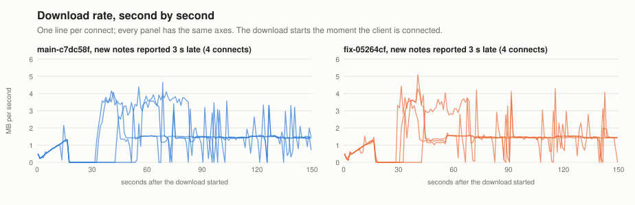

# Main against main with the fix, new notes reported 3 s late, corrected proxy

**Measured:** 8 connects of the lab client to the lab exit, 4 with unmodified `gnosis_vpn-client` main
(`c7dc58f6`) and 4 with the same plus the `hopr-strategy` fix (`05264cf5`), in alternating order, each
followed by a download cut off after 150 s. The Blokli proxy reported new Curvy notes 3 s late in all 8,
with one clock for all notes of a payment.

**Repository commit:** `7e2bd12` (clean working tree; recorded in `measurement.json`, which names the
packaged client version 1.1.0 although the binaries were the two builds)

**Result:** The fixed client recorded all 4 deposits; in the 3 connects where its lookup was exposed to
the lag it found the notes at the fifth lookup. The unmodified client dropped the one deposit whose
lookup was exposed and recorded the 3 that were not. The exit confirmed all 8. Connection times were
5.04 to 5.07 s and the downloads 203 to 213 MB in 150 s with both builds.

This block repeats one condition of [2026-11-22-main-vs-fix](../2026-11-22-main-vs-fix/README.md), where
a flaw of the proxy made one connect of the fixed build fail. Method, combined tables and what the runs
do not show are described there.
