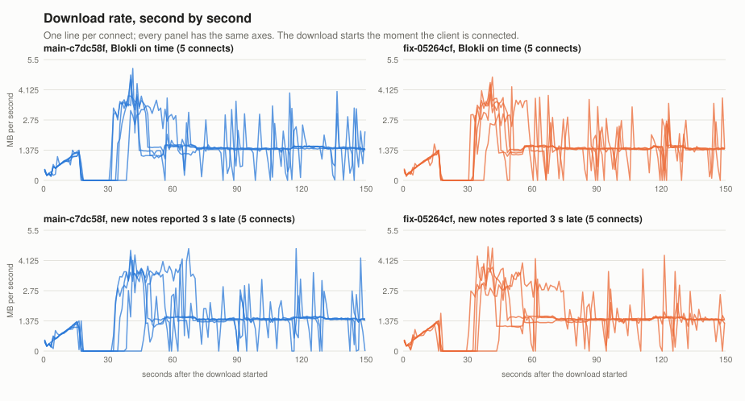

# 2026-11-22: client main against main with the hopr-strategy fix

**Measured:** 28 connects of the lab client to the lab exit with two builds of `gnosis_vpn-client` main at
`c7dc58f6`: unmodified, and with `hopr-strategy` taken from the fix (`05264cf5`, pull request
hoprnet/hopr-strategy#170 with backoff between the lookups). Every connect was followed at once by a
download cut off after 150 s. Recorded per connect: connection time, bytes per second, the exit's
payment-gate counters before and after, whether the client recorded the session's first deposit, and
when the exit confirmed it. The client read Blokli through the lag proxy, which reported new Curvy notes
either at once or 3 s late. This folder has the main run of 20 connects, 5 per build and lag, in
alternating order; [main-vs-fix-lag3](../2026-11-22-main-vs-fix-lag3/README.md) has 8 more under the
3 s lag with a corrected proxy.

**Repository commit:** `3782431` for this folder, `7e2bd12` for the extra block (clean working tree both
times; recorded in each `measurement.json`, which names the packaged client version 1.1.0 although the
binaries were the two builds, whose worker checksums it also records)

**Result:** Connection time and download rate are the same with and without the fix. With new notes
reported 3 s late, the unmodified client recorded none of the 5 deposits that were exposed to the lag;
the fixed client recorded all 6 that were exposed under a correctly working proxy, each at the fifth
lookup. The exit confirmed all 28 deposits. The fix does not touch the pause after about 13 MB: every
one of the 28 connects, with either build, was held by the exit for 12 to 38 s.



All four panels have the same shape: a ramp on the exit's free allowance, no traffic from about 17 s
until the exit has seen the payment, a burst, then a steady 1.4 to 1.5 MB per second.

## What this run is about, and what it is not

Two different faults have been found in this lab. This run is about the second.

| | Payment deadlock | Lost payment record |
| --- | --- | --- |
| What goes wrong | The first payment is late, the exit holds the session, and the relayer's answers are stuck in that session | The payment is made and confirmed, but the client's own state says it is not |
| Seen by the user | A pause after about 13 MB; a connection that stops for good when the payment is slow | Nothing in the traffic; status "payment pending" for the whole session |
| Described in | [payment-deadlock](../2026-11-22-payment-deadlock/README.md) | [blokli-race](../2026-11-22-blokli-race/README.md) |
| Changed by the fix under test | no | yes |

No delay was put on the payment relayer here, so no connection stopped for good. The pause is in every
connect; see "The pause is unchanged" below.

## Connection time and download

| | Unmodified main, 14 connects | With the fix, 14 connects |
| --- | --- | --- |
| `connect` until connected: lowest / median / highest | 4.84 / 5.04 / 5.06 s | 4.84 / 5.05 / 5.07 s |
| Downloaded in 150 s: lowest / median / highest | 206 / 209 / 212 MB | 203 / 210 / 213 MB |
| Median rate from second 60 to 150 | 1.46 MB/s (1.43 to 1.49) | 1.46 MB/s (1.43 to 1.46) |
| Held by the exit's payment gate | 14 of 14 connects, once each | 14 of 14 connects, once each |
| Length of that hold: lowest / median / highest | 14.3 / 17.2 / 37.9 s | 11.6 / 16.1 / 26.8 s |
| Deposit confirmed by the exit, after `connect` | 36.2 / 39.3 / 59.8 s | 33.8 / 38.0 / 49.4 s |
| Session-open timeouts in the client's log | 0 | 0 |

- **No difference between the builds** beyond what single connects vary by.
- **The first long interruption of every download is the exit's hold.** The client's first stall of more
  than 3 s and the exit's counter of time spent holding agree to within 0.4 s in all 28 connects.
- **No loss of rate late in the session.** The runs on Windows with the side-car build lost throughput
  after about 85 s ([windows-android](../2026-11-22-windows-android/README.md)); neither build here does
  within 150 s. Gaps of 1 to 2 s occur 1 to 8 times per connect with both builds.

## Whether the client recorded its deposit

A connect is "exposed" when the client's lookup came while the notes were still pending on Blokli, so the
proxy could hide them. In the other connects the notes were already committed at the client's first
lookup, mostly because the client learned of the inclusion late, and the proxy let them through (see
"How the lag was injected").

| Build | Blokli lag | Connects | Exposed to the lag | Recorded when exposed | Recorded when not exposed |
| --- | --- | --- | --- | --- | --- |
| unmodified | none | 5 | | | 4 of 5 |
| with the fix | none | 5 | | | 5 of 5 |
| unmodified | 3 s | 9 | 5 | **0 of 5** | 4 of 4 |
| with the fix | 3 s, proxy working correctly | 8 | 6 | **6 of 6**, each at the 5th lookup | 2 of 2 |
| with the fix | 3 s, proxy with the flaw | 1 | 1 | 0 of 1 | |

- **One natural case on unmodified main (connect 7, no lag):** Blokli itself answered "unknown" at the
  client's only lookup, and the deposit was dropped from the client's state. The exit confirmed it 39.9 s
  after `connect`.
- **The fifth lookup is the backoff at work:** lookups come 0.25, 0.75, 1.75 and 3.75 s after the first;
  the fourth of these is the first one past the 3 s lag.
- **Every deposit that the client did not record was confirmed by the exit.**

## The pause is unchanged

Both builds pay through the VPN tunnel, as main does. In all 28 connects the exit's free allowance was
used up before it saw the deposit, and it held the session.

In 6 of the 28 connects the client learned that its deposit was included only after the exit had
confirmed it, 46 to 64 s after `connect`: the relayer's answers were held back with the rest of the
session. Those 6 had holds of 21.4 to 37.9 s; the other 22 had 11.6 to 22.3 s. The deposit had been
submitted before the hold began in each of them, which is why they recovered.

## How the lag was injected

`./lab blokli-lag` puts a proxy between the client and Blokli
([remote/blokli-lag-proxy.py](../../remote/blokli-lag-proxy.py)). It forwards everything unchanged
except the note-status query: a note that Blokli reports as pending is reported as unknown for 3 s.
Notes that are already committed the first time they are asked about are never hidden; that protects the
pool's older funding notes, and it is also why a late lookup is not exposed. The exit reads Blokli
directly.

**The proxy had a flaw during the main run.** A payment creates several notes, which the pool checks one
after another, and the proxy ran a separate 3 s clock for each note from the first time that note was
asked about. In connect 11 the fixed client found the first note at 3.75 s, then the second note was
hidden for another 3 s, then the third, and the client gave up at 9.75 s. A real indexer shows all notes
of a transaction at the same moment. In connects 3, 5 and 19 the remaining notes were already committed
and the flaw did not show. The proxy now uses one clock for all notes first seen within 30 s; the extra
block ran with that.

## Design

- **Order:** each round has every build with every lag once; the order of builds and of lags is reversed
  from round to round (`schedule` in `measurement.json`). A build is installed once for its connects of
  a round, and the client is given 45 s after it reports the exit as routable.
- **Same length for every download:** a 1 GB file cut off after 150 s.
- **Counters around every connect:** packet counters of the three relays and the exit's payment-gate
  counters are read before and after, so a hold is attributed to its connect.
- **No refill of the payment pool during a run:** the pool was filled once before each run (the client's
  refill setting raised for one start, then the lab's configuration restored and checked by checksum),
  followed by one unrecorded connect. The first payment after a refill is slower.
- **The lab was used by nothing else.** The exit's log was complete for every connect.

## Not shown by these runs

- **A fix for the pause or for the deadlock.** Neither build changes how or when the payment is made.
- **How the fix behaves when Blokli lags by more than 9.75 s.** That was run with the earlier fixed
  interval ([blokli-race](../2026-11-22-blokli-race/README.md)), not with the backoff.
- **Frequency of the natural race.** 1 of 10 connects without lag here; small samples throughout.
- **Sessions longer than 150 s,** and any client platform other than the lab's Linux client.

## Checks on the fix itself

`hopr-strategy` at `05264cf5`: `cargo test --workspace --exclude hopr-strategy-integration-tests
--all-features` passed (637 + 55 + 2 + 1, 4 ignored), `cargo clippy --all-features --all-targets -- -D
warnings` and `cargo +nightly fmt --check` clean. The integration tests were not run. The client builds
differ only in the source of `hopr-strategy` ([client-build.diff](client-build.diff)).

## Reproduce

```bash
./lab blokli-lag install
./lab compare-builds my-label --builds main-c7dc58f fix-05264cf --lags 0 3 --rounds 5 --seconds 150
./lab blokli-lag remove
```

The builds are folders with the three client binaries under `/root/lab/` on the client machine.

## Files

| File | Content |
| --- | --- |
| `iterations.csv` | One row per connect: build, lag, connection time, download, stalls, relay and exit counters, the client's record of the deposit, the exit's confirmation, the proxy's answers |
| `bytes-per-second.csv` | Bytes received in each second of each download |
| `download-rate.svg` | The chart above |
| `log-excerpts.txt` | Proxy, client and exit lines of connects 7, 3, 11 and 16 |
| `client-build.diff` | The change to `gnosis_vpn-client` for the fixed build |
| `measurement.json` | What, when, commit, schedule, worker checksums of both builds |

Raw samples, counters and logs of every connect are in `raw/2026-11-22-main-vs-fix/` (not in git).
