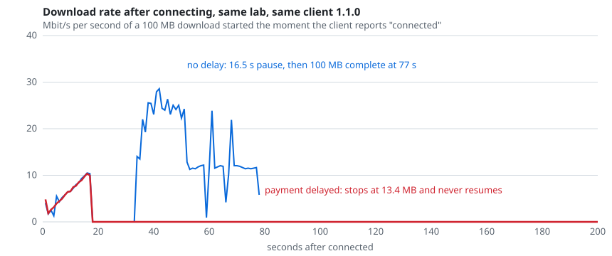

# 2026-11-22: a late first payment stops the connection for good

**Measured:** one iteration of the connect-and-download test with the packaged client 1.1.0 against the
lab exit, while the exit delayed its packets to the payment relayer (`api.curvy.box`) by 3 s
(`./lab relayer-delay on --ms 3000`). Nothing else was changed. Client and exit logs of the run were
checked for any other fault in the session.

**Repository commit:** `e980aeb` (clean working tree; recorded in `measurement.json`)

**Result:** The client connected in 5.1 s and downloaded 13.4 MB in 17 s. Then the download stopped and
never resumed. The exit closed the session after its 3-minute deposit limit; the client reconnected and
committed to a second payment. Registration, session and both path directions worked; the only fault
on either side is the payment.



The blue line is run 1 of [2026-11-21-connect-stall](../2026-11-21-connect-stall/README.md): same
machines, same client, no delay.

## What happens

1. Every new session gets a free allowance from the exit: 10,000 return packets, about 13.3 MB.
2. The client's first payment for the session is prepared and sent in the background, through the VPN
   tunnel, while the user's traffic already flows.
3. When the allowance is used up before the exit sees the payment, the exit holds back all return
   traffic of the session.
4. From then on the answers of the payment relayer cannot reach the client either, because they travel
   in the same held-back session. The payment that would end the hold can no longer be made.
5. Nothing ends this state until a timeout: the exit closes the session 180 s after it received the
   client's commitment.

Without the delay the payment wins the race by a small margin: it has been submitted when the hold
starts, and the hold ends after 13 to 17 s, once the exit sees it on chain. The delay makes the
payment lose the race, which is all it is there for.

## Only the payment path was changed

| Delay on the exit's packets to the relayer | Client | Pause after 13.4 MB | 100 MB download |
| --- | --- | --- | --- |
| none ([connect-stall](../2026-11-21-connect-stall/README.md), 3 runs) | packaged 1.1.0 | 13.2 to 16.6 s | complete |
| 1.5 s ([sim-slow-relayer-control](../2026-11-22-sim-slow-relayer-control/README.md)) | 1.1.0 built from source | 33.4 s | complete |
| 3 s ([sim-slower-relayer-control](../2026-11-22-sim-slower-relayer-control/README.md)) | 1.1.0 built from source | never resumed | stopped at 13.4 MB |
| **3 s (this run)** | **packaged 1.1.0** | **never resumed** | **stopped at 13.4 MB** |

The delay is applied with `tc netem` on the exit, only to packets whose destination is one of the
relayer's addresses ([remote/relayer-delay.sh](../../remote/relayer-delay.sh)). HOPR traffic between
client, relays and exit and the download itself are not delayed.

## Was anything else wrong with the session?

| Checked | Evidence | Verdict |
| --- | --- | --- |
| WireGuard key registration | The exit's server log has one `POST /api/v1/clients/register`, answered `201 Created` at 09:34:24.63, 0.27 s after `connect` was issued. The next one comes at 09:37:26.83, after the timeout. The client's `register_wg` phase lasted 0.22 s. | One attempt, no retry |
| Session opening | Paid session established on the exit at 09:34:24.68 and ready on the client at 09:34:26.19. Each connection phase was passed once; `connected` after 5.06 s. | Normal |
| Forward path | The request reached the download server and 13.4 MB of acknowledgements went out. | Working |
| Return path | 13.4 MB arrived in 17 s, with the same rate curve as the runs without delay (see chart). The client's check ping through the tunnel answered at 09:34:29 (33 ms, 3 of 3) and at 09:34:39. | Working |
| Relays | The three lab relays forwarded 5,455, 5,983 and 6,029 packets during the run: an even split, no relay missing. | Working |
| Why the exit stopped sending | Exit counters over the run: 10,159 packets sent on the free allowance, then one gate block with reason `predeposit_exhausted` lasting 160.5 s. | Payment gate, nothing else |
| Why the session ended | Exit log at 09:37:26.73: `closing PIX SSA ... reason=DepositTimeout phase=AwaitingDeposit`, exactly 180.0 s after it received the commitment (09:34:26.73). | Deposit timeout |
| What failed on the client | From 09:35:15 to 09:37:17, twelve times: `the Curvy relayer is unreachable: error sending request for url (https://api.curvy.box/...)`. Then `deposit flush failed` with the same reason. | Relayer not reachable through the held session |

Two kinds of log lines look like faults but are not specific to this run:

- **`paths ... reason="surbs_not_returning" analysis_required=true`** in the client's once-a-minute state
  report. It is present in 55 of that day's 56 reports, including every run that completed.
- **`Error decoding object from the underlying stream error=connection lost`**, nine lines within 0.1 s
  at 09:34:36. The same lines appear 168 times that day, in completed runs as well. They concern the
  client's direct connections to other nodes of the network.

## Timeline

| UTC | Seconds after `connect` | Source | Event |
| --- | --- | --- | --- |
| 09:34:24.36 | 0.0 | client | `connect` issued |
| 09:34:24.63 | 0.3 | exit | registration answered `201 Created` |
| 09:34:25.15 | 0.8 | client | commitment generated, deposit of 5.94 wxHOPR queued |
| 09:34:26.73 | 2.4 | exit | commitment received; its 180 s deposit limit starts |
| 09:34:29.32 | 5.0 | client | connected; the download starts |
| 09:34:45.76 | 21.4 | client | relayer fee quote: 3 of 4 answers cut short |
| 09:34:46.3 | 21.9 | client | download stops at 13.4 MB (exit: allowance used up, gate closed) |
| 09:35:06.28 | 41.9 | client | `inbound stalled while the exit awaits PIX payment - holding` |
| 09:35:15.76 | 51.4 | client | first `the Curvy relayer is unreachable`; repeated every 10.6 s, 12 times |
| 09:37:26.73 | 182.4 | exit | `DepositTimeout`, session closed |
| 09:37:26.74 | 182.4 | client | session error, reconnects in place |
| 09:37:27.35 | 183.0 | client | new commitment: a second deposit of 5.94 wxHOPR queued |
| 09:37:27.96 | 183.6 | client | `deposit flush failed` for the first session |
| 09:37:31.44 | 187.1 | client | connected again |
| 09:37:56 | 211.8 | test | test ends and disconnects |

## The same outside the lab

A laptop on a home connection, configured like the lab client, showed the same failure twice without
any delay being injected ([2026-11-22-laptop-client](../2026-11-22-laptop-client/README.md)): stopped
at 13.3 and 13.4 MB, never resumed, `the Curvy relayer is unreachable` in its log, `DepositTimeout` on
the exit. The exit's log for those two sessions also shows one registration each, answered
`201 Created` at the first attempt.

With 90 s of idle time between connecting and the download, the same laptop had no interruption at
all: the payment was made 12 s after connecting, with no traffic competing for the allowance.

## Not shown by this run

- Other causes of a stalled or failed connection may exist. This run shows that a late payment alone,
  in an otherwise healthy session, is enough.
- The delay is a lab tool. It does not say how often the payment loses the race outside the lab.
- One iteration. The same condition with the client built from source gave the same result.

## Reproduce

```bash
./lab client start
./lab relayer-delay on --ms 3000
./lab stall-test my-label --yes
./lab relayer-delay off
```

One run costs two payments (11.88 wxHOPR): the first session's and the reconnect's.

## Files

| File | Content |
| --- | --- |
| `iterations.csv`, `bytes-per-second.csv`, `measurement.json` | Output of `./lab stall-test` |
| `client-log-excerpt.txt` | Client worker log of the run: connection, session, payment, warnings and errors |
| `client-ping-excerpt.txt` | The client's check pings through the tunnel |
| `exit-log-excerpt.txt` | Exit log of the run at info level and above: registration, sessions, payment |
| `download-rate.svg` | The chart above |

The full logs are in `raw/2026-11-22-payment-deadlock/` (not in git).
